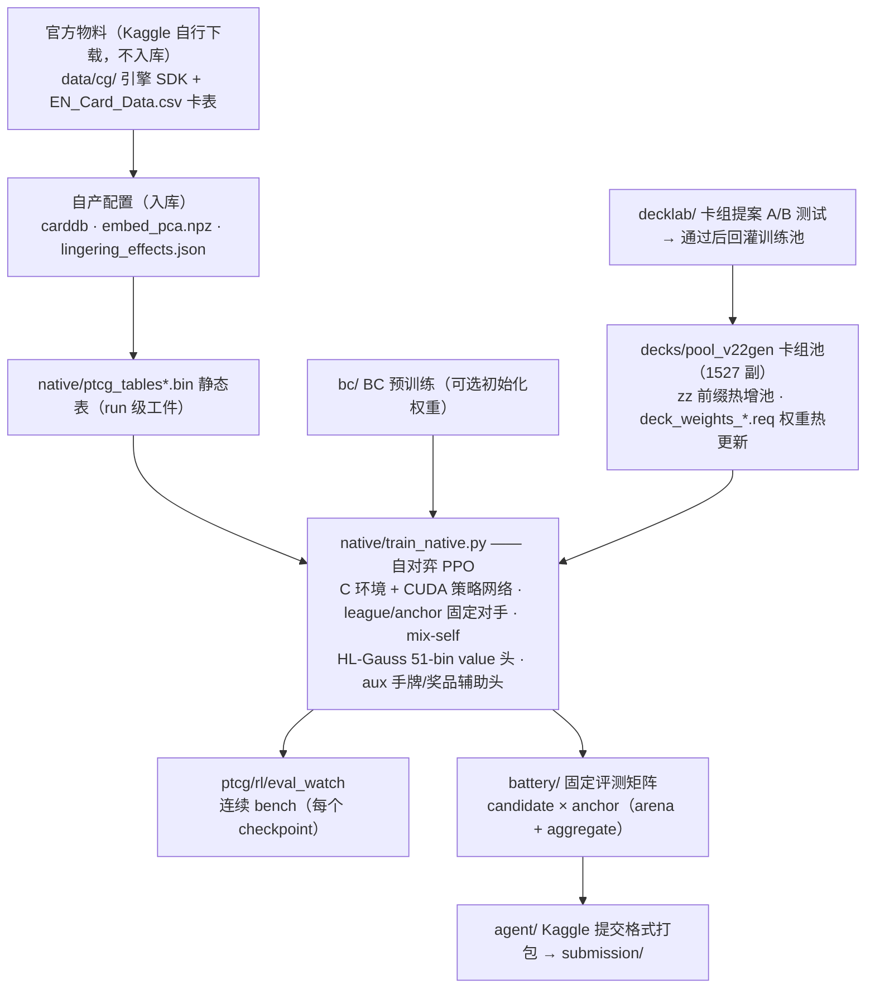

# Pokemon_agent

宝可梦（Pokémon）对战智能体比赛参赛仓库。**比赛进行中，内容持续更新，仓库保持私有。**

## 任务描述

在宝可梦对战环境中训练一个能自主决策的 RL Agent，与对手进行完整对战（选牌、出招、换人、兑现 KO）。
整体流程：行为克隆（BC）预训练 → 自我对弈强化学习多阶段训练 → 提交评测平台打分。

## Framework 总览

一句话：**C 写的对战环境 + CUDA 写的策略网络，链接进一个改造过的 PufferLib 原生训练器做自对弈 PPO（训练循环里没有 PyTorch），卡组池与评测电池围绕训练器热更新。**



要点：

- **训练栈**（`native/`）：C 环境（观测编码 / 隐信息追踪 / 静态表）+ CUDA 前向反向 + vendored PufferLib（打过补丁），单进程多 GPU，fp32。
- **共享运行时**（`ptcg/`）：观测布局、编码器、torch 模型、search agent——训练、评测、Kaggle 提交三方共用同一套定义；观测布局由 `ptcg/rl/buffers.py` 冻结。
- **卡组体系**：deck id = 池目录内 60 行 csv 的排序位置，改池 = 重编号（会作废旧 checkpoint）；训练进行中可热增卡组、热换采样权重。
- **评测体系**：训练内连续 bench（`eval_watch`）+ 训练外固定电池（`battery/`）双层；固定对手以 Kaggle 格式 agent 目录存放（`opponents/`，权重不入库）。
- 上游原版框架说明（英文，含逐文件布局表）：[docs/UPSTREAM_README.md](docs/UPSTREAM_README.md)。

## 目录结构

| 目录 | 内容 |
|---|---|
| `native/ptcg/` | C 游戏环境：obs / 编码器 / tracker / tables / 事件流 / 卡组池热插拔 + `test_*.c` 契约测试 |
| `native/model/` | CUDA 策略网络（前向 + 反向），编译期尺寸宏；可选 MoE 专家头（`PTCG_MOE=1`，v21 实验分支） |
| `native/src/` `native/patches/` | PufferLib c5d3c63 + 本地补丁（见 `PATCHES.md`） |
| `native/train_native.py` | 训练驱动：flags、resume、league banks、卡组池/权重热更新、telemetry |
| `native/tools/` | 权重转换（`native_weights.py`）、表导出（`export_tables.py`）、supervisor、parity 检查、`make_hl_init.py`（HL-Gauss 头初始化） |
| `ptcg/rl/` | `buffers.py`（观测布局，冻结）、`encoder.py`、`model.py`、`search_agent.py`、`env.py`、`eval_watch.py`、`arena.py`、`cards.py`（卡牌查表 + embed） |
| `ptcg/tracker.py` `ptcg/effects.py` | 隐信息追踪器、残留效果模型（配 `data/lingering_effects.json`） |
| `decks/` | 训练卡组池：`pool_v22gen`（1527 副，当前主力）、`pool_union`、`pool`（上游原 616 池）等 + 采样权重 `deck_weights_*.req` |
| `battery/` | 固定评测电池：anchor / candidate 卡组清单、`run_battery.sh`、`aggregate.py` |
| `decklab/` | 卡组实验室配置与 gauntlets（`config.json`、`field15/30.txt`） |
| `tools/` | decklab harness、deck 矩阵分析、eval / arena 运行器、`build_carddb.py`、`make_opponents.sh` |
| `opponents/` | 固定评测对手（Kaggle 格式 agent 目录）；仅 README 入库，权重不入库 |
| `bc/` | BC 预训练：`extract.py`（episode → 决策样本）、`train_bc.py`（masked NLL）、`quality_gate.py` |
| `agent/` | Kaggle 提交格式模板 |
| `submission/` | 上游 release 附带的提交打包样例（模板） |
| `data/` | 自带运行时配置（`embed_pca.npz`、`lingering_effects.json`）；官方引擎/卡表自行下载，不入库（见 [data/README.md](data/README.md)） |
| `docs/` | 分域文档 + v21/v22 设计与复盘记录 + `UPSTREAM_README.md`（见下方文档索引） |
| `setup/` | `bootstrap.sh` + `requirements.txt` |
| `.github/workflows/` | 上游自带的 CI 配置 |

## 当前训练（v22 系列，后台 screen 进行中）

主力 run `v22_c1_hl_2b`，相对上游 C1 布局的主要差异：HL-Gauss 51-bin value 头、aux 手牌/奖品辅助头（0.3）、state-history 3。启动命令（去掉机器本地路径后的核心部分）：

```bash
PTCG_TABLES=native/ptcg_tables_v22gen.bin PTCG_HL=1 \
PTCG_AUX_HAND=0.3 PTCG_AUX_PRIZE=0.3 \
PYTHONPATH=data:.:native python3 -u native/train_native.py \
  --run-name v22_c1_hl_2b --timesteps 2000000000 \
  --total-agents 1536 --minibatch 768 --num-threads 16 --gpus 4 --cudagraphs -1 \
  --seed 42 --no-resume \
  --deck-pool decks/pool_v22gen --deck-weights-file decks/deck_weights_v22gen.req \
  --lr 0.001 --ent-coef 0.01 --mix-self 0.98 \
  --anchor-decks <固定对照卡组，逗号分隔> \
  --checkpoint-interval 100 --state-history 3
```

v21/v22 各阶段的消融设计与复盘见 `docs/`（设计稿、评审、7 小时实验报告等）。

## 历史状态（v19）

v19 是目前效果最好的版本，也是第一个真正意义上的 baseline：

- 采用数据规模驱动的方式：扩充对战数据量，让模型见足够多的局面与决策。
- 训练与评测管线已跑通，评测成绩稳定优于之前的尝试。
- 初步结论：在这个任务上，"数据量大、力出奇迹"比复杂的技巧性改进更有效。

## 快速开始

1. 按 [data/README.md](data/README.md) 从 Kaggle 下载官方引擎与卡表放进 `data/`（不入库）。
2. `bash setup/bootstrap.sh` 安装依赖。
3. `bash native/build_native.sh` 编译（需 nvcc / NCCL / `data/cg/libcg.so`）。
4. 用短的 `--timesteps` 跑 smoke；完整说明见 [docs/UPSTREAM_README.md](docs/UPSTREAM_README.md) 与 `docs/training.md`。

## 文档索引

| 文档 | 内容 |
|---|---|
| [docs/UPSTREAM_README.md](docs/UPSTREAM_README.md) | 上游原版总说明（英文，逐文件布局表 / 设置） |
| `docs/training.md` | native 训练器 |
| `docs/model.md` | 观测与网络 |
| `docs/engine.md` | 官方模拟器 |
| `docs/eval.md` | 评测 |
| `docs/deck-pool.md` | 卡组池与表 blob |
| `docs/decklab.md` | 卡组实验室 |
| `docs/design_moe5_v1_20261121.md` `docs/moe5_7h_report_20261122.md` | MoE 专家头设计与 7 小时实验报告 |
| `docs/plan_v21_optimizer_20261119.md` `docs/v21_split_review_20261119.md` `docs/lesson_c2_sparse_advantage_batch_20261121.md` | v21/v22 迭代的设计、评审与教训 |
| `AGENTS.md` | 改代码前必读的仓库约定与 6 条不变量 |

## TODO

- [x] 上传训练 / 评测代码与配置（v22 快照）
- [x] Framework 总览与目录结构说明（mermaid 简版）
- [ ] 正式 framework 框架图（待手绘草图后绘制）
- [ ] 补充数据构造说明
- [ ] 比赛结束后整理开源
