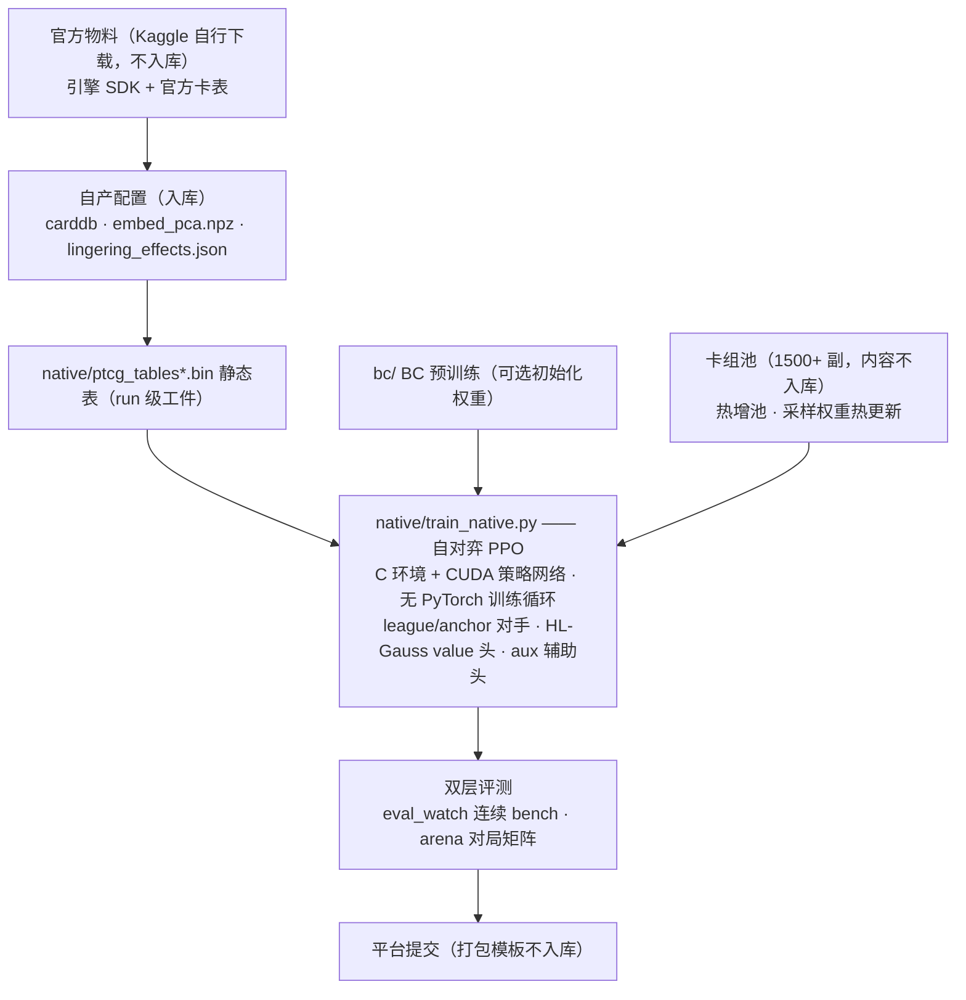

# Pokemon_agent

宝可梦（Pokémon）对战智能体比赛（Kaggle *PTCG AI Battle*）参赛仓库。**比赛进行中，仓库保持私有。**

本仓库是训练 / 评测代码的**精选快照**，聚焦两件事：**模型的选取与建立**、**训练工程**。卡组池内容、提交包、固定评测电池配置、对手权重等比赛细节物料保存在训练机本地，不入库。

## 任务描述

在宝可梦对战环境中训练一个能自主决策的 RL Agent，与对手进行完整对战（选牌、出招、换人、兑现 KO）。
整体流程：行为克隆（BC）预训练 → 自我对弈强化学习多阶段训练 → 提交评测平台打分。

## 核心工作

**模型（选取与建立）**

- **策略网络**：token-transformer 策略，观测布局 v4 由 `ptcg/rl/buffers.py` 冻结（改动会同时作废 checkpoint、C 编码器与静态表）；前向 + 反向全部用 CUDA 手写（`native/model/`），训练循环内没有 PyTorch。
- **value 头**：从标量 value 迁移到 **HL-Gauss 51-bin 直方图回归头**（`native/tools/make_hl_init.py` 负责旧权重的零成本布局迁移）。
- **辅助头**：手牌 / 奖品牌预测辅助损失（`PTCG_AUX_HAND` / `PTCG_AUX_PRIZE`），帮助隐信息状态学习。
- **隐信息建模**：`ptcg/tracker.py`（对手手牌 / 奖品分布追踪）+ `ptcg/effects.py` + `data/lingering_effects.json`（从卡牌文本提炼的残留效果记录）。
- **文本 embedding**：卡牌 / 招式 / 特性文本 → embedding → PCA 压缩成静态表（`tools/embed_card_texts.py` → `build_embed_pca.py` → `data/embed_pca.npz`）。
- **可选 MoE 专家头**（`PTCG_MOE=1`，5 个按卡组族的专家头）：v21 期实验分支，结论是无族内增益，主力 run 未启用——设计消融见 `docs/`。

**训练工程**

- **全原生自对弈 PPO 栈**：C 环境驱动官方模拟器 + CUDA 策略网络 + vendored/patched PufferLib（`native/patches/`，CI 校验补丁与上游 commit 一致），单进程多 GPU（4 卡 + CUDA graphs）。
- **卡组池热更新**：训练进行中可热增卡组（`zz` 前缀约定保证 deck id 稳定）、热换采样权重（`deck_weights_*.req`）；deck id = 池内排序位置，是贯穿全栈的关键不变量。
- **对手结构**：league bank + 固定 anchor 卡组对照（`--mix-self 0.98`），anchor 权重随训练里程碑刷新。
- **双层评测**：训练内每个 checkpoint 跑连续 bench（`ptcg/rl/eval_watch.py`）+ 训练外 arena 多进程贪心对局矩阵（`ptcg/rl/arena.py`）。
- **BC 预训练管线**：官方对局 episode → 决策样本（`bc/extract.py`）→ masked NLL（`bc/train_bc.py`）→ 质量门（`bc/quality_gate.py`）。

## Framework 总览



上游原版框架说明（英文，含逐文件布局表）：[docs/UPSTREAM_README.md](docs/UPSTREAM_README.md)。

## 目录结构

| 目录 | 内容 |
|---|---|
| `native/ptcg/` | C 游戏环境：obs / 编码器 / tracker / tables / 事件流 / 卡组池热插拔 + `test_*.c` 契约测试 |
| `native/model/` | CUDA 策略网络（前向 + 反向 + 辅助损失 + HL-Gauss value 头），编译期尺寸宏 |
| `native/src/` `native/patches/` | PufferLib c5d3c63 + 本地补丁（`PATCHES.md`，CI 校验一致性） |
| `native/train_native.py` | 训练驱动：flags、resume、league banks、卡组池/权重热更新、telemetry |
| `native/tools/` | 权重转换（`native_weights.py`）、表导出（`export_tables.py`）、supervisor、parity 检查、HL-Gauss 头初始化 |
| `ptcg/rl/` | `buffers.py`（观测布局，冻结）、`encoder.py`、`model.py`、`search_agent.py`、`env.py`、`eval_watch.py`、`arena.py`、`cards.py`（卡牌查表 + embed） |
| `ptcg/tracker.py` `ptcg/effects.py` | 隐信息追踪器、残留效果模型 |
| `bc/` | BC 预训练：样本抽取 / masked NLL 训练 / 质量门 |
| `tools/` | 数据与 embedding 构建（`build_carddb.py`、`embed_card_texts.py`、`build_embed_pca.py`）、观测契约校验（`validate_obs_v4.py`）、评测 runner（`selfeval*.py`、`make_opponents.sh`） |
| `data/` | 自带运行时配置（`embed_pca.npz`、`lingering_effects.json`）；官方引擎/卡表自行下载，不入库（见 [data/README.md](data/README.md)） |
| `docs/` | 分域文档 + v21/v22 设计与复盘记录（见下方索引） |
| `setup/` | `bootstrap.sh` + `requirements.txt` |

**未包含（比赛物料，训练机本地）**：官方引擎与卡表（Kaggle 自取）、卡组池内容与 decklab 工具、固定评测电池配置、Kaggle 格式对手权重、提交包模板、checkpoint 与日志。

## 当前训练（v22 系列，后台 screen 进行中）

主力 run `v22_c1_hl_2b`，相对上游 C1 布局的主要差异：HL-Gauss 51-bin value 头、aux 手牌/奖品辅助头（0.3）、state-history 3。启动命令（去掉机器本地路径后的核心部分）：

```bash
PTCG_TABLES=native/ptcg_tables_v22gen.bin PTCG_HL=1 \
PTCG_AUX_HAND=0.3 PTCG_AUX_PRIZE=0.3 \
PYTHONPATH=data:.:native python3 -u native/train_native.py \
  --run-name v22_c1_hl_2b --timesteps 2000000000 \
  --total-agents 1536 --minibatch 768 --num-threads 16 --gpus 4 --cudagraphs -1 \
  --seed 42 --no-resume \
  --deck-pool decks/pool_v22gen --deck-weights-file decks/deck_weights_v22gen.req \
  --lr 0.001 --ent-coef 0.01 --mix-self 0.98 \
  --anchor-decks <固定对照卡组，逗号分隔> \
  --checkpoint-interval 100 --state-history 3
```

## 迭代历史与设计文档

| 文档 | 内容 |
|---|---|
| [docs/UPSTREAM_README.md](docs/UPSTREAM_README.md) | 上游原版总说明（英文） |
| `docs/training.md` | native 训练器 |
| `docs/model.md` | 观测与网络 |
| `docs/engine.md` | 官方模拟器 |
| `docs/eval.md` | 评测 |
| `docs/design_moe5_v1_20261121.md` `docs/moe5_7h_report_20261122.md` | MoE 专家头设计与 7 小时实验报告（结论：无族内增益，不进主力） |
| `docs/plan_v21_optimizer_20261119.md` `docs/v21_split_review_20261119.md` `docs/lesson_c2_sparse_advantage_batch_20261121.md` | v21/v22 迭代的设计、评审与教训复盘 |

## 历史状态（v19）

v19 是第一个真正意义上的 baseline：

- 采用数据规模驱动的方式：扩充对战数据量，让模型见足够多的局面与决策。
- 训练与评测管线已跑通，评测成绩稳定优于之前的尝试。
- 初步结论：在这个任务上，"数据量大、力出奇迹"比复杂的技巧性改进更有效。

## 快速开始

1. 按 [data/README.md](data/README.md) 从 Kaggle 下载官方引擎与卡表放进 `data/`（不入库）。
2. `bash setup/bootstrap.sh` 安装依赖。
3. `bash native/build_native.sh` 编译（需 nvcc / NCCL / `data/cg/libcg.so`）。
4. 用短的 `--timesteps` 跑 smoke；完整说明见 [docs/UPSTREAM_README.md](docs/UPSTREAM_README.md) 与 `docs/training.md`。

注：卡组池内容等比赛物料不在仓库中，完整复现训练需要配合本地物料。

## 致谢

训练栈基于 [Team Unown Gradiant](https://www.kaggle.com/competitions/pokemon-tcg-ai-battle-challenge-strategy/writeups/team-unown-gradiant-solution-all-decks-on-hand)（Dipam Chakraborty）的开源 release 改造，保留其 [LICENSE](LICENSE) 与引用信息（[CITATION.cff](CITATION.cff)）；v21/v22 的模型改动、卡组池与评测体系迭代为本项目工作。

## TODO

- [x] 上传训练 / 评测代码与配置（v22 快照，简历导向精简版）
- [x] Framework 总览与目录结构说明（mermaid 简版）
- [ ] 正式 framework 框架图（待手绘草图后绘制）
- [ ] 比赛结束后整理开源
